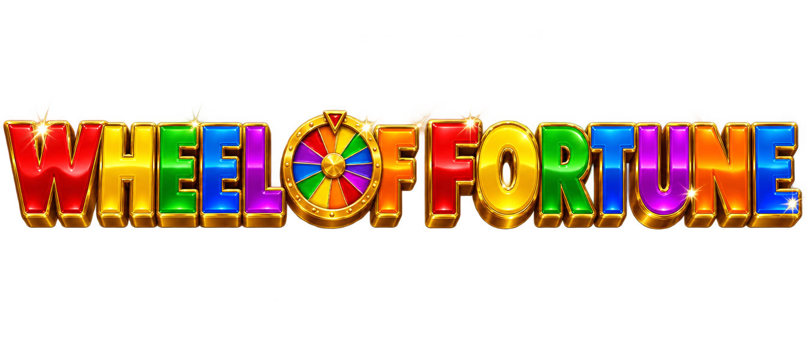
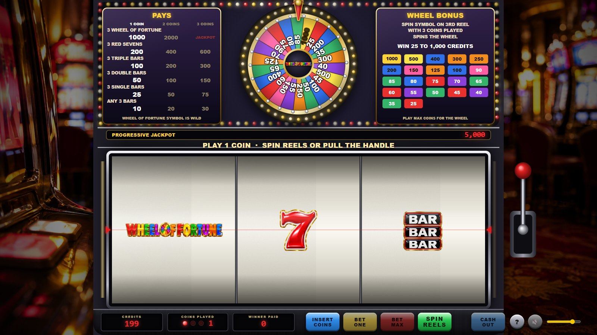
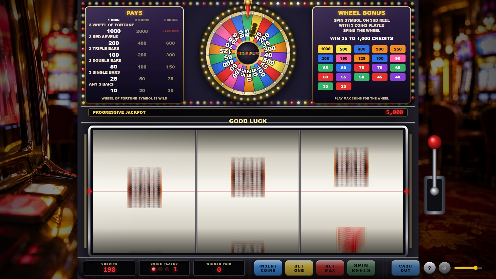
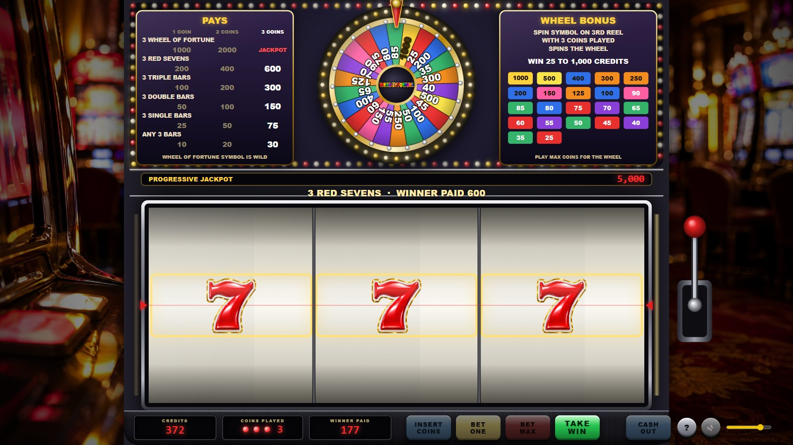
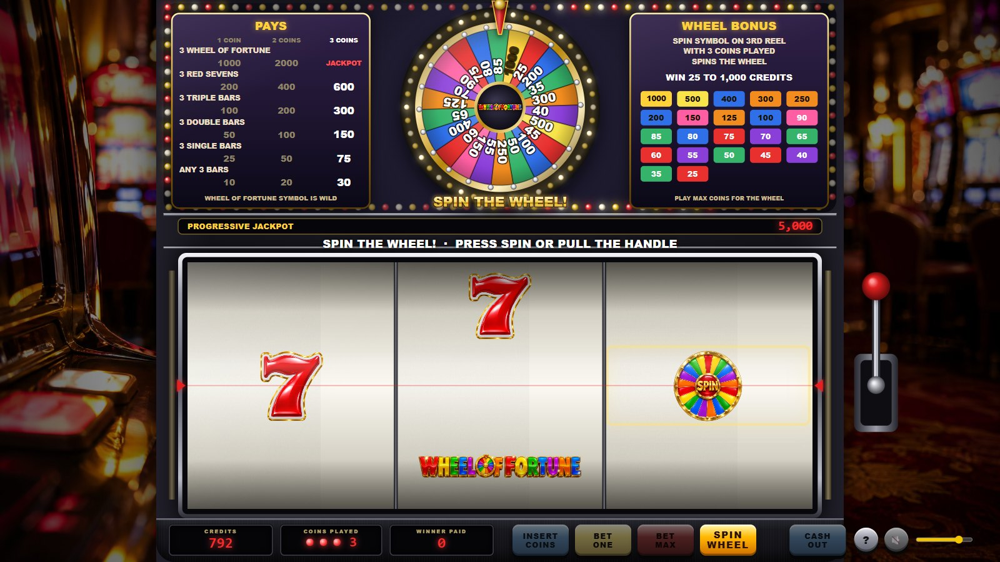
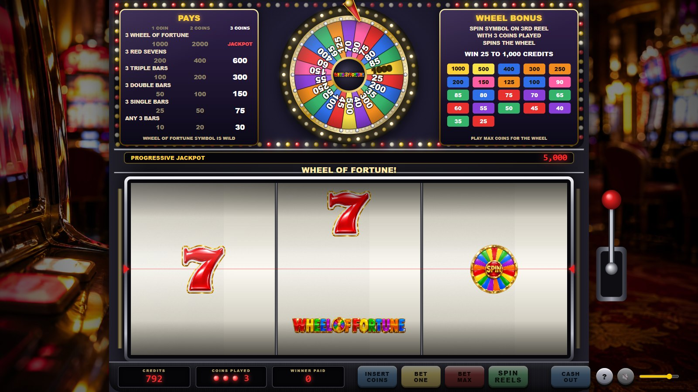
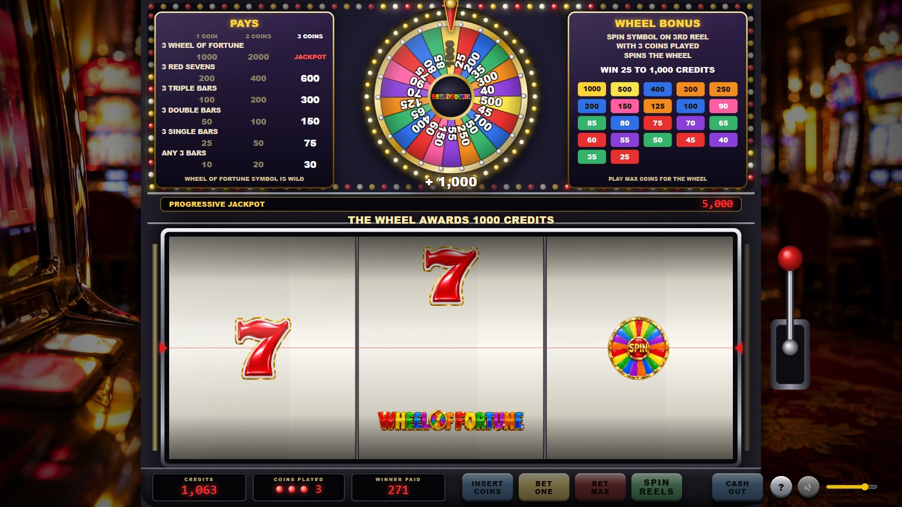
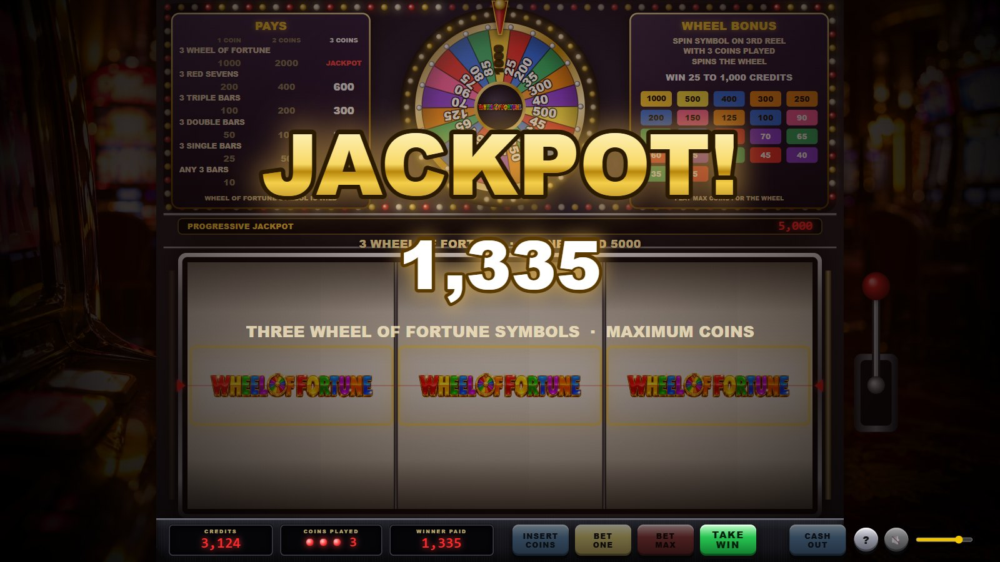
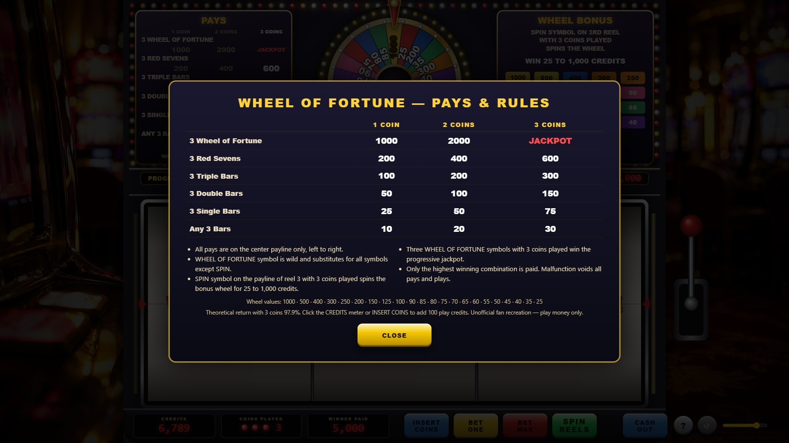

<div align="center">



### A photoreal recreation of the classic three-reel *Wheel of Fortune* slot machine with its bonus wheel


-97.9%25-d4af37)


</div>

Plain HTML5 Canvas, Web Audio and vanilla JavaScript. No frameworks, no build
step, no server-side code. The reels are **weighted virtual-stop steppers**
exactly like the real machines (22 physical stops, blanks between symbols,
heavy blanks beside the logo so it "almost" lands), the 22-wedge wheel is
weighted too, and the bundled tool prints the exact par sheet.

> Unofficial fan recreation for entertainment only. Wheel of Fortune is a
> trademark of its owners. Play money, no real wagering.

---

## Contents

1. [Features](#features)
2. [Platforms](#platforms)
3. [Installation](#installation)
4. [Configuration reference](#configuration-reference)
5. [User guide](#user-guide)
6. [Keyboard shortcuts](#keyboard-shortcuts)
7. [Known limitations](#known-limitations)
8. [Project layout](#project-layout)
9. [Development](#development)

---

## Features

**Game**

* Three reels, one centre payline, 1–3 coins (BET ONE, BET MAX, SPIN REELS,
  a handle you can pull, CASH OUT, INSERT COINS)
* Classic pays: 3 logos 1000 / 2000 / **progressive jackpot**, 3 red sevens
  200 / 400 / 600, triple bars 100 / 200 / 300, double bars 50 / 100 / 150,
  single bars 25 / 50 / 75, any three bars 10 / 20 / 30; the logo is wild
* **SPIN on reel 3 with three coins** arms the bonus wheel; with fewer coins the
  machine tells you to play max, like the original
* **The wheel:** 22 weighted wedges from 25 to 1,000 credits, average award 53.6,
  the 1,000 wedge about 1 in 250 spins of the wheel
* Progressive jackpot meter that grows by 3 % of every bet and resets after a hit

**Exact par sheet (`node tools/rtp-sim.js`)**

| Figure | Value |
| --- | --- |
| Virtual stops per reel | 121 / 121 / 116 (classic profile 115) |
| Any pay | 1 in 23 spins |
| SPIN on the payline (wheel) | 1 in 58 spins (classic 1 in 115) |
| Wheel average award | 37.6 credits, the 1,000 about 1 in 510 wheel spins (classic 53.6 and 1 in 252) |
| Three red sevens | 1 in 1,700 |
| Three logos (jackpot) | 1 in 210,000 |
| Return, 1 or 2 coins | 76.3 % (classic 76.7 %) |
| Return, 3 coins | 76.3 % base + 21.6 % wheel = **97.9 %** (classic 77.0 % + 15.5 % = 92.5 %) |

The default *arcade* profile spins the wheel about twice as often on a flatter wheel; `?classic=1`
in the address bar (or `WOF_PROFILE=classic` for the tools) restores the original balance.

**Physics and presentation**

* Stepper reels: quick wind-up, fast spin with blur, abrupt stop and a short
  spring bounce; a payline marker, cream printed strips, drum shading and glass
* Wheel: constant-deceleration spin lasting six to eight seconds that ends inside
  the predetermined wedge, a spring-loaded flapper kicked by every peg, chasing
  bulbs around the rim, the winning wedge flashing
* Cabinet: casino-floor backdrop, glossy upright cabinet with chasing lights,
  pay glass and bonus rules, LED meters, chrome trims, animated handle
* Celebrations: coin showers, sparkles, a JACKPOT overlay with ringing bells

**Sound (synthesized in Web Audio, plus one generated voice line)**

* Stepper-motor whir that follows reel speed, symbol ticks, mechanical stops
  with rising tones, coin-in clinks, credit roll-up dings, hopper payout
* Wheel flapper clicks that slow with the wheel, stop thud, award bells and fanfares
* The studio-audience chant when the wheel is armed: three generated voices
  layered and detuned into a crowd (a synthesized stand-in plays offline)
* Jackpot bells, attract jingle, volume slider and mute

---

## Platforms

| Platform | Status | Notes |
| --- | --- | --- |
| Chrome / Edge (desktop) | Tested | Headless Chrome drives the smoke test and screenshots |
| Firefox (desktop) | Expected to work | Standard Canvas 2D and Web Audio only |
| Safari (macOS / iOS) | Expected to work | Audio starts after the first tap |
| Android / iOS browsers | Playable | Scene scales to the screen; landscape recommended |
| Offline / `file://` | Works | The chant clips need HTTP; a synthesized chant plays instead |

Requirements: a browser with Canvas 2D, Web Audio and ES2020. Node.js 22+ only
for the optional tools.

---

## Installation

1. **Get the files.** Keep `assets/`, `css/` and `js/` next to `index.html`.
2. **Serve it (recommended):**

   ```bash
   python -m http.server 8766
   ```

   or double-click `start.cmd` on Windows, then open <http://localhost:8766/>.
3. **Or open `index.html` directly** from disk (Chrome, Edge).
4. **Click once** on the splash screen to unlock audio. You start with 200 play
   credits; INSERT COINS adds 100 at any time.
5. Optional URL parameters: `?mute=1` starts silent; see
   [Development](#development) for outcome forcing.

### Configuration reference

| Setting | File | Default | Meaning |
| --- | --- | --- | --- |
| `startCredits` | `js/config.js` | `200` | Credits on load |
| `maxCoins` | `js/config.js` | `3` | Coins per spin |
| `jackpotBase`, `jackpotRate` | `js/config.js` | `5000`, `0.03` | Progressive reset value and growth per credit bet |
| `PAYS[].pays` | `js/config.js` | classic table | Total award for 1 / 2 / 3 coins per combination |
| `LAYOUT` | `js/config.js` | 22 stops per reel | Physical symbol order on each reel |
| `PROFILES` | `js/config.js` | `arcade`; `?classic=1` switches | SPIN weight and wheel weights: arcade spins the wheel 1 in 58 (average 38 credits), classic 1 in 115 (average 54) |
| `WEIGHTS` | `js/config.js` | tuned to 97.9 % (classic 92.5 %) | Virtual stops per symbol; `BLANK_NEAR_WOF` is the near-miss weight |
| `WHEEL[].value`, `.weight`, `.color` | `js/config.js` | 22 wedges | Wheel values, odds and colours |
| reel physics (`vmax`, `accelTime`, `overshoot`, `omega`, `zeta`) | `js/game.js` | `34`, `0.22`, `0.1`, `30`, `0.55` | Stepper speed, acceleration, bounce |
| `spinTo` duration / turns | `js/wheel.js` | 6.4–7.6 s, 5–7 turns | Wheel spin feel |
| stop timing (`stopAt`) | `js/game.js` | 0.95 / 1.3 / 1.65 s | When each reel is told to stop |
| `WHEEL`, `REEL`, `CAB` | `js/renderer.js` | layout constants | Scene geometry in the 1920 × 1080 frame |
| `wof.volume`, `wof.muted` | browser `localStorage` | `0.8`, `0` | Remembered volume and mute |

After changing weights, pays or wheel odds run `node tools/rtp-sim.js`.

---

## User guide

### The cabinet



The top box holds the wheel with its chasing lights, the pay glass on the left
(the column for the coins you have in is lit) and the bonus rules on the right.
Below sit the progressive meter, the three reels behind glass with the red
payline marker, the message line and the control deck. The handle on the right
pulls.

### Playing



Press **BET ONE** to add coins (1 → 2 → 3 → 1), **BET MAX** to play three coins
and spin at once, **SPIN REELS** or the handle to spin. Reels stop left to right
with a clunk and a tone; wins roll up into CREDITS with the WINNER PAID meter
counting along. **CASH OUT** pays the credits to the hopper, coin by coin.



### The wheel bonus



When SPIN lands on the payline of the third reel with three coins in, the
cabinet lights race, the crowd chants and the SPIN REELS button becomes SPIN
WHEEL. Press it (or pull the handle) to spin.



The wheel decelerates for six to eight seconds while the flapper clicks over the
pegs, lands on a wedge and awards its value.



### Jackpot



Three logos on three coins pay the progressive meter, with ringing bells and a
coin shower; the meter resets to 5,000 afterwards.

### Help



Press **?** (or `H`) for the pay table, the rules and the wheel values.

---

## Keyboard shortcuts

| Key | Action |
| --- | --- |
| `Space` / `Enter` | Spin reels · spin wheel · take win · continue |
| `L` | Pull the handle |
| `1` | Bet one coin |
| `3` / `M` | Bet max and spin |
| `I` | Insert 100 play credits |
| `C` | Cash out |
| `H` | Help |
| `S` | Mute / unmute |
| `Esc` | Close help |

---

## Known limitations

* The original machine's par sheet is proprietary; the weights here reproduce
  the published behaviour (a weighted 22-wedge wheel of 25–1,000 triggered by
  SPIN on reel 3 at max coins, near-miss blanks). The classic profile's 92.5 % three-coin
  return was chosen to match quarter steppers, not the exact IGT figures; the default arcade
  profile trades a flatter wheel for twice as many wheel spins at 97.9 %.
* The logo reel symbol uses the generated title logo because the image model
  refused the square reel-symbol render of the words.
* Credits are play money and are not saved between visits.
* Browsers block sound until the first click; the splash exists for that.
* The chant clips are fetched over HTTP; from `file://` a synthesized three-hit
  chant plays instead.
* No real-money functionality of any kind, by design.

---

## Project layout

```
wheel-of-fortune-slot/
├── index.html            page: canvas, control deck, help, splash
├── start.cmd             Windows launcher (local server + browser)
├── css/style.css         control deck, LED meters, buttons, overlays
├── js/
│   ├── config.js         symbols, pays, reel layout + weights, wheel wedges, evaluation
│   ├── audio.js          shared Web Audio synthesizer engine
│   ├── audio-wof.js      stepper, coin, bell, wheel and chant sounds
│   ├── reel.js           reel physics (shared engine)
│   ├── wheel.js          bonus wheel physics (deceleration profile, flapper, pegs)
│   ├── assets.js         image loading, blurred symbol variants, textures
│   ├── fx.js             sparkles, coins, flash (shared engine)
│   ├── renderer.js       cabinet, lights, pay glass, wheel, reels, lever, overlays
│   ├── game.js           coins/credits flow, evaluation, roll-ups, bonus, jackpot
│   ├── ui.js             DOM deck, lever hit area, help, keyboard
│   └── main.js           bootstrap, frame loop, test hooks
├── assets/
│   ├── symbols/*.png     seven, bars, spin (transparent renders)
│   ├── logo.png          title logo (also the reel symbol and hub emblem)
│   ├── bg/casino.jpg     casino-floor backdrop
│   └── audio/chant*.mp3  three generated chant voices
├── docs/
│   ├── index.html        GitHub Pages landing page
│   └── screenshots/      images used here and on the landing page
└── tools/
    ├── rtp-sim.js        exact par sheet (pay frequencies, wheel, return per coins)
    ├── rtp-lib.js        shared maths
    ├── tune.js           weight scans used to hit the target return
    ├── tune-arcade.js    SPIN-weight and wheel-weight scans behind the arcade profile
    ├── screenshots.mjs   headless-Chrome smoke test + screenshots (no dependencies)
    └── pngalpha.py       alpha-channel report for PNG assets
```

---

## Development

**Run locally:** `python -m http.server 8766` (or `start.cmd`), open
<http://localhost:8766/>. No build step.

**Force outcomes while testing:**

| Parameter | Outcome |
| --- | --- |
| `?force=spin` | SPIN on reel 3 (arms the wheel with 3 coins) |
| `?force=wof` | three logos (jackpot with 3 coins) |
| `?force=sevens` | three red sevens |
| `?force=bars` | mixed bars |
| `?force=blank` | all blanks |
| `?wheel=<0–21>` | wheel lands on that wedge (0 = 1,000) |
| `?mute=1` | start muted |

In the console, `WOF.step(seconds)` advances the simulation deterministically
and `WOF.game` exposes the state machine.

**Check the maths:** `node tools/rtp-sim.js` prints the exact par sheet;
`node tools/tune.js [target] [minHit]` scans weight tables.

**Regenerate screenshots / smoke test:** `node tools/screenshots.mjs` launches
headless Chrome or Edge, drives every state (win, bonus, wheel, jackpot, help)
and fails on any page error.

**Publish:** enable GitHub Pages for the repository root; the game is served at
`/` and the landing page at `/docs/`.
